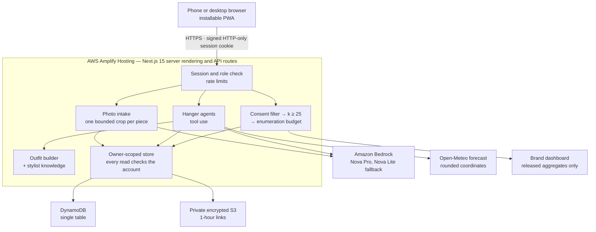

# Racked — Privacy-First Wardrobe Intelligence for Consumers and Brands

[](https://github.com/manof1color/racked-wardrobe-intelligence/actions/workflows/ci.yml)
[](https://github.com/manof1color/racked-wardrobe-intelligence/actions/workflows/codeql.yml)

**Brands know what consumers buy. Racked shows them what consumers actually wear — without ever seeing anyone's closet.**

People get a private wardrobe and an AI stylist that dresses them from what they already own. Brands see how their products are really worn, but only as totals from at least 25 people who opted in: never a name, photo or wardrobe.

**[Try the demo, no sign-up](https://main.d2iv0khybuuaeh.amplifyapp.com/login#try-the-demo) · [Judge guide](JUDGES.md) · [One-page summary](docs/one-page-summary.md) · [Evidence](#evidence-and-what-is-not-claimed)**

<!-- Screenshots go here: three phone screenshots from the live demo (scan → confirm, a product hidden at 4 owners, the same view released at 50), saved under docs/images/. -->

- **92.8% of garments placed in the right category** by the live scan, on 300 independent photos with answers locked before the first model call ([results](docs/evaluation-results-r2.md))
- **Nothing below 25 owners, not even a count:** the threshold runs in code before any total is computed ([privacy](#privacy-and-security))
- **Checked on every change:** lint, type check, the full test suite, accessibility checks and CodeQL ([testing](#testing-and-ci))

<!-- pilot:start (generated from data/pilot-status.json; tests/pilot-claims.test.ts) -->
**Pilot status (2026-11-07):** Three apparel brands, **_victimdesigns**, **vversatile.usa** and **Project Qadar**, have agreed to join the Racked pilot, created brand accounts, uploaded their products and accepted pilot pricing.

| Brand | What it has done | Evidence |
| --- | --- | --- |
| _victimdesigns | agreed to join the pilot by phone; created a brand account; uploaded products; accepted pilot pricing (Brand Basic) | [victimdesigns-pricing-2026-11-04.jpg](docs/pilot-evidence/victimdesigns-pricing-2026-11-04.jpg), [victimdesigns-plan-choice-2026-11-06.jpg](docs/pilot-evidence/victimdesigns-plan-choice-2026-11-06.jpg) |
| vversatile.usa | agreed to join the pilot by phone; created a brand account; uploaded products; accepted pilot pricing (Brand Basic) | [vversatile-pricing-2026-11-05.jpg](docs/pilot-evidence/vversatile-pricing-2026-11-05.jpg) |
| Project Qadar | agreed to join the pilot in writing; created a brand account; uploaded products; accepted pilot pricing (Brand Pro) | [projectqadar-plan-2026-11-07.jpg](docs/pilot-evidence/projectqadar-plan-2026-11-07.jpg) |

Not claimed: payment. Nothing is billed.
<!-- pilot:end -->

---

## Judge Scorecard

| Category | Weight | What to look for | Verify it |
| --- | ---: | --- | --- |
| **Problem & relevance** | 20% | A sale is where a brand stops seeing; Racked measures confirmed wear, released only at 25 or more owners | [What this is](#what-this-is) · [Impact](#why-this-matters-more-wear-less-waste) · [One-page summary](docs/one-page-summary.md) |
| **Functionality** | 25% | Two live flows: **scan → confirm → outfit**, and **anonymous cohort → wear evidence → campaign brief** | [Live app](https://main.d2iv0khybuuaeh.amplifyapp.com) · [Demo path](#five-minute-judge-path) · [Judge accounts](docs/judge-accounts.md) |
| **AI integration & innovation** | 20% | **92.8%** category accuracy on 300 locked photos; Hanger, a tool-using agent, won **11 of 12 decided** blind comparisons with a random valid outfit (8 ties); Brand Hanger sees released totals only | [How AI is used](#how-ai-is-used) · [Recognition](docs/evaluation-results-r2.md) · [Hanger holdout](#hanger-outfit-recommendations--blind-holdout-evaluation) · [AI use log](docs/ai-use-log.md) |
| **Code, docs & GitHub** | 15% | **1134 tests** in 137 files; CI with accessibility checks and CodeQL; **231 merged PRs** counted on 2026-11-12 before this documentation merge; build log through Phase 121 | [Testing](#testing-and-ci) · [Architecture](#architecture-overview) · [PROGRESS.md](PROGRESS.md) |
| **UX & polish** | 10% | Mobile-first installable app; a step-by-step judge guide inside the demo; honest empty and suppressed states | [Open it on a phone](https://main.d2iv0khybuuaeh.amplifyapp.com) · [Brand UX review](docs/brand-ux-review.md) |
| **Business impact** | 10% | Three real brands joined the pilot and uploaded products; one chose the $40 Pro plan in writing. Illustrative break-even: 20 excess units at a $25 landed cost | [Impact and assumptions](docs/sustainability-and-business-impact.md) · [Pricing](#business-model--pricing-proposed--not-currently-billed) |
| **Bonus** | — | Consent, `k ≥ 25`, a daily enumeration budget, encrypted storage, two-step sign-in for brands, owner-scoped deletion | [Privacy and security](#privacy-and-security) · [Security testing](#security-testing-and-hardening) · [SECURITY.md](SECURITY.md) |

Per-criterion evidence: [docs/competition-checklist.md](docs/competition-checklist.md).

---

## Five-Minute Judge Path

Open the [sign-in page](https://main.d2iv0khybuuaeh.amplifyapp.com/login) (or **Try the demo: no sign-up** on the home page) and use **Try the demo**: choose **Judge Consumer** for the first flow, then **Judge Brand** for the second. A **judge guide** at the top of each demo opens every step below in one click and ticks it off when done. Everything outside these two flows is built and working: see [Additional Live Features](#additional-live-features).

**A person: scan → confirm → recommendation** (2½ minutes) — **Judge Consumer**

1. **Scan.** Tap **+** and photograph a garment. Amazon Bedrock (Nova Pro) proposes each visible piece's category and type.
2. **Confirm.** Check each card and save. When the AI is unsure, the **Type** field asks instead of guessing; nothing is saved unconfirmed.
3. **Recommendation.** Open **Hanger** and ask *"What should I wear with this today?"* It dresses you only from pieces this account owns.

**A brand: anonymous cohort → wear evidence → campaign brief** (2½ minutes) — **Judge Brand**

4. **The privacy gate.** Open **Judge Limited Overshirt**: 4 opted-in owners, below `k ≥ 25`, so the brand sees nothing, not even the count.
5. **The anonymous cohort.** Open **Judge Signature Tee**: 50 consented owners, so totals are released: an eight-week wear chart, repeat wear, and what it is worn with.
6. **The campaign brief.** Ask **Brand Hanger** *"Write me a campaign brief for this product."* It uses only the released totals; on the hidden product it declines and makes no model call.

---

## Demo Access

**One click, no password.** The sign-in screen's **Try the demo** opens any of the four accounts below. Judge Consumer is a fresh private copy of a lived-in wardrobe; Judge Brand is the shared demo brand, read-only; the two **New** accounts start empty. Everything a judge adds is gone after a day, and no demo can reach a real person or brand ([rules](lib/demo-session.ts), [details](docs/judge-accounts.md)).

| Account | Address | What it shows |
| --- | --- | --- |
| Judge Consumer | `judge.consumer@racked.local` | A lived-in wardrobe: 13 pieces, saved outfits, a realistic wear spread, two **verified** brand pieces |
| Judge Brand | `judge.brand@racked.local` | **Judge Signature Tee** with **50 opted-in owners** (released) beside **Judge Limited Overshirt** with 4 (suppressed), in a fictional catalog of 30 products. The seed gives 15 of the 30 enough owners for wear data and leaves 15 below the threshold, labelled **Wear data open** or **Too few owners** with a filter (demo products only) |
| New Consumer | `judge.newconsumer@racked.local` | Empty on purpose: scan a real photo and see the first-run states |
| New Brand | `judge.newbrand@racked.local` | No products: enrol one from a single photo with **Fill in from photo** (a private brand per judge, up to 5 products) |

**Passwords are deliberately not in this repository.** It is public, and a committed password would let anyone alter the demo before it is reviewed; credentials reach judges privately. Every seeded record is classified `DEMO` and every seeded image is marked `SYNTHETIC DEMO`. The accounts describe repeatable seed expectations, not a live-table audit or real-user statistics. Tour, seeding and the read-only checker (`pnpm verify:judge`): [docs/judge-accounts.md](docs/judge-accounts.md).

---

## What This Is

Purchase history stops at the transaction. It cannot show whether a product was worn once, became a favourite, sat untouched, or anchors outfits with other pieces.

1. **A wardrobe and stylist for people** — photograph your clothes, build outfits, record what you wear (earning private [wear points](docs/brand-linking-incentives.md#wear-points-owner-decision-2026-10-29) for it), bring underused pieces back into rotation, and talk to Hanger, an AI stylist that only ever dresses you from what you own.
2. **Actual-wear intelligence for brands** — confirmed wear, repeat use and pairings for a brand's own products, released only when at least 25 opted-in owners qualify.
3. **Optional public discovery** — an outfit someone deliberately publishes becomes a Community look others can recreate from their own closets.

**Who it is for.** People who own more clothes than they can keep track of and want a private place to sort them out and get outfits from what they already have. And apparel brands that want to know how their products are really worn after the sale, without asking anyone to hand over a closet.

---

## Why This Matters: More Wear, Less Waste

Racked began with my experience in Kenya, where I saw the consequences of clothing waste and wanted to connect consumer usefulness with better information for brands. The product works before disposal: recycling tries to recover value after clothing becomes waste; Racked helps a garment remain useful in the wardrobe and gives its maker evidence about what earned continued use.

The scale is documented, but the claims are kept specific:

| Evidence | Why it matters to Racked |
| --- | --- |
| In a large UK study, the average adult owned 118 clothing items and **26% — about 31 pieces — had not been worn in the previous year** ([WRAP](https://www.wrap.ngo/resources/report/citizen-insights-clothing-longevity-and-circular-business-models-receptivity-uk)) | Hanger builds from owned garments, the ranker favors rotation when requested, and wear points give a private reason to bring a piece back after 60 days |
| From 2000 to 2015, clothing production doubled while the number of times an item was worn before disposal fell **36%** ([Ellen MacArthur Foundation](https://www.ellenmacarthurfoundation.org/fashion-business-models/overview)) | Racked measures use after purchase rather than treating the sale as the end of the product story |
| Globally, **73%** of material used for clothing is eventually landfilled or burned, while less than **1%** of old clothing becomes new clothing ([Ellen MacArthur Foundation](https://www.ellenmacarthurfoundation.org/articles/wearnext)) | Extending use and learning which products remain useful complement reuse and recycling; Racked does not claim that software alone solves end-of-life waste |

**The consumer value:** see what is owned, rediscover underused pieces, build new combinations, repeat saved outfits, and recognize a real wardrobe gap before buying a duplicate.

**The brand value:** use privacy-released repeat-wear, longevity and pairing signals to inform restocks, production quantities, product development, merchandising and campaign creative. At the proposed $40 monthly Pro price, the plan that releases wear data, the annual cost is $480. As an illustration — not a measured customer result — avoiding **20 excess units at a $25 landed cost** would cover that annual subscription ($480 ÷ $25 = 19.2, so 20 whole units). The assumptions and formulas are explicit in [Sustainability and business impact](docs/sustainability-and-business-impact.md).

**The early market signal:** three independent apparel brands, **_victimdesigns**, **vversatile.usa** and **Project Qadar**, have agreed to the pilot, created brand accounts and uploaded products, and all three accepted the proposed pricing in writing. _victimdesigns on 2026-11-04 ([redacted message](docs/pilot-evidence/victimdesigns-pricing-2026-11-04.jpg)) and vversatile.usa on 2026-11-05 ([redacted message](docs/pilot-evidence/vversatile-pricing-2026-11-05.jpg)) each said it would look at the Basic plan ($20 as the messages put it) while using full pilot access. Project Qadar chose the higher plan on 2026-11-07: "Go ahead and put me in for the $40 advanced plan as we talked about on the phone" ([redacted message](docs/pilot-evidence/projectqadar-plan-2026-11-07.jpg)); the advanced plan is the one this site calls Pro. vversatile.usa's wording is "down to try it", a willingness to try rather than a signed commitment. That is observed participation and three written price acceptances, stronger than hypothetical survey interest. It does **not** yet prove payment, recurring usage, waste reduction or financial return; nothing is billed during the pilot, and those are the next measurements.

Kenya's circular-economy work identifies textiles, apparel and fashion as a priority and emphasizes extending product life and minimizing waste ([State Department for Environment and Climate Change](https://environment.go.ke/index.php/ministry-validates-national-circular-economy-strategy-and-implementation-plan-2027-2032)). UNEP has also documented Kenyan businesses returning textile waste to use through collection and upcycling ([UNEP](https://www.unep.org/en/news-and-stories/story/kenya-textiles-get-second-life)).

---

## Architecture Overview


<details>
<summary><strong>The same diagram as text — expand</strong></summary>



</details>

Amplify deploys `main` automatically; DynamoDB is one on-demand table; S3 is private and encrypted with public access blocked; Bedrock runs in `us-east-2` from the app's own AWS account, so no AI key reaches a browser. Details: [docs/architecture.md](docs/architecture.md), including a module map, and every route in [docs/backend-api.md](docs/backend-api.md).


**At a glance**

| | |
| --- | --- |
| **Stack** | Next.js 15 · React 19 · TypeScript · AWS Amplify (SSR) · DynamoDB · private S3 · Amazon Bedrock (Nova Pro, Nova Lite) · GitHub Actions · CodeQL · Stripe Checkout (test mode only) |
| **Payments** | None real. The one payment step is Stripe **test mode** on fictional products: [try it with the test card](#stripe-test-mode-no-real-money) |
| **Security** | Audited with Cloudflare's open-source security-audit skill, a 63-check attack harness, and CodeQL on every change: [how it was tested and what stops an attacker](#security-testing-and-hardening) |
| **What is deployed right now** | [`/api/version`](https://main.d2iv0khybuuaeh.amplifyapp.com/api/version) returns the exact commit Amplify built |

---

## Additional Live Features

Built, live and tested, but outside the five-minute demo:

| Area | What it does | Where it lives |
| --- | --- | --- |
| **Community & Recreate** | **Private by default:** nothing is public until its owner picks one saved outfit and presses **Publish this outfit**, and only that outfit appears, under new public IDs. **Unpublish** takes it down again at any time (`DELETE /api/community/[postId]`). Anyone signed in can see how much of a public look their own closet makes | [`community-feed.tsx`](components/community-feed.tsx) · [`recreate-look.ts`](lib/recreate-look.ts) |
| **Shop the Look** | Only a registry-verified product with a validated destination is shoppable | [`commerce.ts`](lib/commerce.ts) |
| **Brand linking** | A barcode, or brand plus style code, verifies a piece against the brand registry; look-alikes and search link it as the owner's own pick. A brand name alone verifies nothing | [`product-registry.ts`](lib/product-registry.ts) · [`catalog-match.ts`](lib/catalog-match.ts) |
| **Brand enrollment** | Up to six products at once; **Fill in from photo** proposes the details and the brand supplies the style code. New brands are approved before they can enroll, up to 300 products each | [`brand-product-enrollment.tsx`](components/brand-product-enrollment.tsx) · [brand approval](docs/brand-approval.md) |
| **Batch scanning** | Up to **6 photos** in one pass, every piece in one review list, bounded at 24 pieces | [`garment-intake.tsx`](components/garment-intake.tsx) |
| **Wear points and daily streak** | Recording what you wear earns private points — 1 per piece a day, +3 for a piece back in rotation after 60 days, up to 15 a day — and a daily streak for every day with a recorded wear, with "Log today's outfit" on Home, or **Log with a photo**: Racked suggests the pieces from your own closet and records nothing until you confirm them. Earned identically whether or not you share with brands, never seen by a brand, and each piece reaches brand data at most once a day | [`wear-points.ts`](lib/wear-points.ts) · [`wear-photo-match.ts`](lib/wear-photo-match.ts) · [rules](docs/brand-linking-incentives.md#wear-points-owner-decision-2026-10-29) |
| **Stripe test checkout** | A fictional product can be paid for on Stripe's hosted test page with a test card. No money moves, no order is created, and a real brand's product is refused | [`test-checkout.ts`](lib/test-checkout.ts) · [how to try it](#stripe-test-mode-no-real-money) |
| **Outfits, wear and Looks** | Saved outfits with private flat-lay boards, one-tap repeat wear, and a swipe-through builder that uses the same ranker as Hanger with no AI call | [`looks-builder.tsx`](components/looks-builder.tsx) |

### Next Steps

Not built yet: raise exact-type recognition (74.6% today) and the dress/top boundary, now the most common miss in the [measured benchmark](docs/evaluation-results-r2.md); a learned segmenter that beats the [measured crop baseline](docs/segmentation-backends.md); Next.js 16 after judging; production password-reset email once Amazon SES grants it; [App Store and Google Play](docs/app-store-launch.md). **Security next step: edge rate limiting with AWS WAF** in front of the Amplify app, so per-address limits are applied before a request reaches the app and still hold when the shared counters are unreachable. It is planned, not built, and not in place today: it adds a recurring AWS charge, so it waits for the owner's decision on cost. **Cost:** at AWS's list prices (checked 2026-11-12) one web ACL with one per-address rate rule is about **$6 a month** ($5 for the ACL, $1 for the rule) plus $0.60 per million requests, which pilot traffic keeps to cents; confirm current rates before enabling. **Trigger:** turn it on before the first brand is billed, or sooner if the rate-limit alarms show sustained abuse ([SECURITY.md](SECURITY.md#still-open)).

---

## How AI Is Used

| Task | Model | When it fails |
| --- | --- | --- |
| Finding the garments in a photo — a consumer scan, or a brand's **Fill in from photo** | Amazon Nova Pro (US profile) | An unreadable result becomes one editable "needs your label" card, never invented attributes |
| Hanger, for consumers and brands | Amazon Nova Pro, Nova Lite as fallback | A reply written without the model is built from the wardrobe and **says so on screen** |
| Weather for Hanger | Open-Meteo — not AI | Coordinates rounded to about 1 km; without a location Hanger never guesses |

**Hanger is an agent, not a script.** Nova Pro reads each message and calls the tools it needs through the Bedrock Converse tool-use API — up to five rounds inside a 22-second budget: `search_wardrobe` (only the signed-in wardrobe), `build_outfits` (the **only** way an outfit reaches the screen), `get_weather`, and `get_trends` (anonymous totals from public looks). A reply listing an outfit the builder never made is corrected once, then abandoned. The conversation and standing preferences live on the account, so "swap the shoes" refers to the right look after a reload. The person's own words outrank the model's tool arguments: the request is read for its dress code or activity from a curated set of 37 briefs and 20 named looks, a swap keeps every other piece, and a card always has a top and bottom or a dress, with shoes, unless the person asked otherwise or the closet cannot supply them.

**Stylist knowledge, written down and tested.** The outfit builder ranks with a curated dataset, not a black box: [`lib/garment-knowledge.ts`](lib/garment-knowledge.ts) puts every garment type on a five-step formality ladder, and a named occasion is a gate before rotation, so "a more formal outfit" reaches for the dressiest pieces owned. [`tests/stylist-regression.test.ts`](tests/stylist-regression.test.ts) holds the regression cases from a real reported closet.

**What the AI is never allowed to do:** put an outfit on screen the builder did not build from owned pieces; verify a brand (only a registry barcode, or brand plus style code, can); state the weather without a forecast; infer body shape, gender, age, ethnicity, income or health; see another account's wardrobe; or give a brand anything below `k ≥ 25`.

### What calls a model, and what does not

**Only the consumer Hanger is an agent** in the strict sense: a model that decides which tools to call. Brand Hanger is a single model call over released aggregates. Everything else is deterministic code that gives the same answer to the same input.

| Action | Calls a model? | What decides | Runs in |
| --- | --- | --- | --- |
| Finding the garments in a photo — a consumer scan, or a brand's **Fill in from photo** | **Yes** — Nova Pro, one call per photo | The model proposes pieces; code crops them, joins shoe pairs, maps them onto the taxonomy, and saves nothing until a person confirms | `lib/look-garment-detection.ts` · `POST /api/garments/detect` |
| A Hanger conversation | **Yes** — Nova Pro, one to five calls per message | The model chooses tools; the tools are code | `lib/hanger-agent.ts` · `POST /api/agents/consumer` |
| Hanger's tools: wardrobe search, outfit builder, Racked trends | No | Search over the account's own pieces; the outfit ranker with the stylist knowledge datasets (garment formality and weather; dress codes, activities and named looks) | `lib/outfit-ranking.ts`, `lib/garment-knowledge.ts`, `lib/occasion-knowledge.ts` |
| Hanger's weather tool | No — a forecast service, not AI | Open-Meteo, coordinates rounded to about 1 km | `lib/weather.ts` |
| Hanger when the agent cannot answer | Only after a fast failure: one plain reply, no tools | The turn planner and the outfit ranker; the reply says it was written without the stylist model | `lib/hanger-turn.ts`, `lib/hanger-consumer-turn.ts` |
| Brand Hanger | **Yes, only when released** — one reply, no tools; **none** below `k ≥ 25` | The privacy gate decides first | `lib/hanger-conversation.ts` · `POST /api/agents/brand` |
| Looks: today's pick, Shuffle, Finish | No | The same outfit ranker, in the browser | `lib/looks-rows.ts` |
| Verifying a brand product from its label code | No | A whole-code GTIN, or brand plus style code, against the registry | `lib/product-registry.ts` |
| Look-alike products and catalog search | No | Weighted attribute match against enrolled products | `lib/catalog-match.ts` |
| "Recreate with my wardrobe" | No | Owned / substitute / missing scoring with per-piece evidence | `lib/recreate-look.ts` |
| Whether a brand may see an aggregate at all | No | Consent filter, `k ≥ 25`, enumeration budget | `lib/privacy.ts`, `lib/metrics.ts` |

> **Is the AI trained on clothing photos? Not by Racked.** Racked uses Amazon Bedrock Nova models as supplied and does not fine-tune them. Where it needs domain knowledge it writes it down and tests it: the controlled garment taxonomy, a reference of 23 generic shoe classes that grounds recognition, and the formality ladder above. Recognition accuracy is measured, not asserted: [92.8% category accuracy on 300 independent photos](#evidence-and-what-is-not-claimed).

---

## Evidence, and what is not claimed

**Recognition accuracy, measured on the live scan (2026-10-29).** Racked ran the exact scan the app runs — the code behind `POST /api/garments/detect`, with the same prompt, the same Nova Pro model and the same 1,600-pixel photo — on photos from the independent CC BY 4.0 [Clothing Dataset for Second-Hand Fashion](https://zenodo.org/records/13788681). Every answer and photo was locked by hash before the first model call, so nothing could be tuned after seeing results.

It ran twice. **Round 1** measured the scan as it was and found its most common mistake: hoodies and cardigans proposed as outerwear, although Racked's own taxonomy files them as tops. The prompt was given that boundary. **Round 2** then measured the fixed scan on **300 fresh photos it had never been tuned on** — none shared with round 1.

| Measure (95% confidence interval) | Round 1 — before the fix | **Round 2 — current scan, fresh photos** |
| --- | --- | --- |
| **Garment category correct** | 262 of 292 — 89.7% (85.7%–92.7%) | **272 of 293 — 92.8%** (89.3%–95.3%) |
| Exact type correct, on photos labelled with a type | 100 of 168 — 59.5% (52.0%–66.6%) | **138 of 185 — 74.6%** (67.9%–80.3%) |
| Hoodies, cardigans and other tops proposed as outerwear | 18 photos | **1 photo** |
| Products marked "verified" by AI alone | 0 | **0** — only registry evidence verifies a product |
| Scans that came back unlabelled | 0 of 292 | 0 of 293 |
| Service timeouts, where the person is offered manual entry | 8 of 300 — 2.7% | 7 of 300 — 2.3% |

Both rounds together cost **$3.51 of Bedrock time** as counted (with a 1.5× safety margin; each round under a hard cap). The most common miss now is a dress proposed as a top (11 photos); every proposal is shown to the person to confirm or change before anything is saved. [Round 2 results](docs/evaluation-results-r2.md) · [Round 1 results](docs/evaluation-results.md) · [method](docs/evaluation.md#live-path-benchmark-the-scan-the-app-actually-runs) · aggregates [round 1](data/evaluation-live-2026-10-29.json), [round 2](data/evaluation-live-2026-10-29-r2.json) · locks [round 1](data/evaluation-lock.json), [round 2](data/evaluation-lock-r2.json)

### Hanger outfit recommendations — blind holdout evaluation

**Hanger won 11 head-to-head comparisons, lost 1, and tied 8** across 20 answerable requests. It won **91.7% of decided comparisons** against randomly assembled valid outfits from the same closets (11 of 12 decided cases, 95% confidence interval: 64.6%–98.5%).

| Check | Result |
| --- | --- |
| Valid outfits for answerable requests | **20 of 20** |
| Swaps that changed only the requested item | **4 of 4** |

Two blind raters independently reviewed 24 requests across four fresh synthetic closets. The preference result covers the 20 answerable requests. Four requests for unavailable items were evaluated separately. [Tested commit](https://github.com/manof1color/racked-wardrobe-intelligence/commit/5a9eeae8dafcef51966d000833e682d91728dc9a) · [Scored holdout report](docs/hanger-evaluation-results-holdout-1.md) · [Evaluation method and limitations](docs/hanger-evaluation.md#what-it-can-and-cannot-prove)

<!-- real-use:start (generated from data/pilot-usage.json; tests/real-use.test.ts) -->
**Real use: not measured yet.** Racked has counted, since 2026-10-28, how often people keep the AI's proposal for a scanned piece unchanged, as anonymous daily totals for real (non-demo) accounts. The first snapshot will be published here, with any count under 5 shown as "fewer than 5".
<!-- real-use:end -->

**Synthetic demo cohort.** The main cohort seed deterministically defines each of three hero products with **76 confirmed wears across 25 opted-in owners** — reproducible seed expectations, not a live-table audit or real-user statistics. The table shows **raw synthetic seed values**, the plain calculation before any release rule. They are not what a brand sees for this cohort:

| Signal | Raw synthetic seed value | The question it answers | Brand dashboard |
| --- | ---: | --- | --- |
| Engagement | **22 of 25 active owners (88%)** | How many owners have worn it at least once? | Withheld |
| Repeat use | **19 of 25 repeat wearers (76%)** | Is it earning repeated use? | Withheld |
| Zero-wear opportunity | **3 of 25 owners** | Where could styling help? | Withheld |

**Why a 25-owner cohort still releases none of these.** Passing `k ≥ 25` protects the cohort, not a small group inside it. The release rules (`releaseWearAnalytics` in [`lib/metrics.ts`](lib/metrics.ts)) withhold any owner count under 5, and any count whose remainder is under 5: "22 of 25 active" also says that 3 have never worn it. Here the "0 wears" and "1 wear" groups hold 3 owners each, so the wear breakdown is withheld, and with it every figure derived from it: total wears, active owners, engagement, repeat wear, zero-wear owners, the average and median, the high-frequency count and the weekly trend. The dashboard shows "withheld", never zero, and releases only the day of the latest wear. In the demo, the **Judge Signature Tee** (50 owners) and 14 other synthetic products with their own cohorts are where figures are released.

Before the benchmark, a label-coverage audit of 1,000 dataset records found **93.9%** map to Racked's categories, **62.6%** are specific enough for exact-type scoring, and **94.0%** carry usable brand annotations. These measure benchmark compatibility, not model accuracy ([report](data/evaluation-label-coverage.json)).

Racked does **not** claim recognition accuracy beyond the measured benchmark above, sales lift, purchase intent, demographic inference, virtual try-on, or production-scale validation. Every seeded record is synthetic and classified `DEMO`. Pricing is a proposal; nothing is billed, and Racked takes no real payments: the only payment step is Stripe **test mode** on fictional demo products, where no money moves.

### What we chose not to build, and why

| Not built | Why |
| --- | --- |
| **Real payments or billing** | Three real brands use the live app, and taking their money is not the goal during the pilot. The [checkout accepts only Stripe test keys](#stripe-test-mode-no-real-money) |
| **Any brand view below 25 owners, at any price** | No tier weakens consent or the threshold. A paid exception would break the promise the product is built on |
| **Virtual try-on, body-fit prediction or demographic inference** | Each would need the AI to infer body shape or personal traits, which it is [never allowed to do](#how-ai-is-used). Looks are flat-lay compositions |
| **A custom-trained model** | Racked uses Amazon Nova as supplied, writes its domain knowledge down and tests it, and measures accuracy on locked photos |

Edge rate limiting (AWS WAF) is the planned next security step ([Next Steps](#next-steps)) and upload malware scanning is deliberately not bought; each adds a recurring AWS charge, and this project is kept free of new recurring spend until the owner decides otherwise. Their risk is covered by the per-address and per-account limits in the app and by re-encoding every photo. Automated brand approval is an open item planned after the competition. [SECURITY.md](SECURITY.md) lists each gap and what limits it.

---

## Privacy and Security

The full list, with what is still open, is in [SECURITY.md](SECURITY.md) and [docs/privacy-and-ethics.md](docs/privacy-and-ethics.md).

- **Brands see groups, never people.** Only opted-in owners count, nothing is released below `k ≥ 25`, any figure about fewer than five owners is withheld, and a brand can open at most six distinct products a day so results cannot be lined up. Opting out removes a person from every aggregate at once.
- **Consent is explicit and recorded.** Sharing is off until switched on, and every change is kept with the exact wording the person saw. Publishing to Community is a separate, deliberate act that can be undone.
- **Photos stay private.** Encrypted S3 with public access blocked, links that expire in an hour, location data stripped, and scan photos nobody keeps deleted within two days.
- **AI never decides identity or access.** A brand name read by AI only prefills an unverified label; registry evidence alone verifies a product.
- **Accounts are hardened.** scrypt password hashes at OWASP's recommended cost (older hashes upgrade at their owner's next sign-in), signed HTTP-only sessions, an enforced Content Security Policy with a fresh script nonce on every page, shared sign-in limits, a bot trap, a 90-day activity log without IP addresses, and optional two-step sign-in for brands. New brands are approved before they can enroll anything. Demo sessions cannot publish, change sign-in settings, edit the demo brand or reach a real brand's numbers.
- **Abuse costs the attacker, not Racked.** Rate limits on every write, and daily AI budgets per account and site-wide that fail closed.
- **People can leave.** Deleting a piece, an outfit, a Community look, or the whole consumer account is owner-scoped and retry-safe.

**Disclaimer.** The AI can be wrong. Its recognition accuracy is measured above and is high but not perfect, which is why nothing is saved until a person confirms it. The demo accounts and cohort are synthetic and labelled `DEMO`, pricing is a proposal and nothing is billed, the only payment step is Stripe test mode on fictional products (a test card, no real money, nothing ships, no subscription), and Racked does not claim recognition accuracy beyond the measured benchmark, sales lift, purchase intent, demographic inference, virtual try-on, or production-scale validation. This is a contest entry, source-available for evaluation under its [LICENSE](LICENSE), not a finished commercial service.

---

## Security Testing and Hardening

Racked holds photos of what people own, and real brands use it, so protecting that data got as much work as any feature. I attacked and reviewed the app in several independent ways, and each one changed the code.

**How it was tested**

| Method | What it did | What came of it |
| --- | --- | --- |
| **Code audit** with Cloudflare's open-source [security-audit skill](https://github.com/cloudflare/security-audit-skill) (2026-11-02) | A multi-phase review of the whole codebase, with each finding verified independently | Fixes merged in [#211](https://github.com/manof1color/racked-wardrobe-intelligence/pull/211), [#214](https://github.com/manof1color/racked-wardrobe-intelligence/pull/214), [#215](https://github.com/manof1color/racked-wardrobe-intelligence/pull/215) and [#216](https://github.com/manof1color/racked-wardrobe-intelligence/pull/216): demo protections, sign-in limits shared across servers, brand registry and Community visibility, and guards on Community writes and analytics releases. The report stays private because this repository is public |
| **Attack harness** ([`scripts/security-harness/`](scripts/security-harness)) | Drives the real routes of a production build with synthetic accounts: password guessing, forged addresses, one account reaching for another's data, privileged fields, cohorts one owner short of release | **63 of 63 checks passed**, and the leak check passed (2026-10-27) |
| **Live probes** after a deploy, read-only and signed out | Cross-site writes, forged `X-Forwarded-Host`, oversized bodies, and requests for `/.env` and `/.git` | 403, 403, 413 and 404. The public scripts hold no credentials and no source maps |
| **AI attack tests** ([`ai-privacy-boundaries.test.ts`](tests/ai-privacy-boundaries.test.ts)) | Injected tool calls (`delete_account`, `set_role`), an instruction hidden in a garment name, tool arguments naming another account | Each one changes nothing |
| **CodeQL, dependency audit and Dependabot** | CodeQL on every pull request and weekly, a production dependency audit on every change, Dependabot weekly; CodeQL and the audit must pass before anything reaches `main` | Reviewing one CodeQL alert properly found password hashes at an eighth of OWASP's minimum cost. They were raised to it |
| **Secret scan** (October 2026) | Every line added in every commit on every branch, plus the built browser code | No credential was found, and no `.env` file was ever committed |
| **Three hardening passes** (2026-10-21 to 2026-10-26) | Looked for real gaps instead of new features | Among what they closed: no browser security headers, rate limits that did not hold across servers, and request bodies that were never checked |

**AI tools and skills used for security work.** Judges can check each of these against the repository; none is described here beyond what the repository records.

| Tool or skill | Used for | Where it is on record |
| --- | --- | --- |
| **Cloudflare [security-audit skill](https://github.com/cloudflare/security-audit-skill)** (open source, run through an AI coding agent) | The whole-codebase security review of 2026-11-02 | [SECURITY.md](SECURITY.md), and the fixes in [#211](https://github.com/manof1color/racked-wardrobe-intelligence/pull/211), [#214](https://github.com/manof1color/racked-wardrobe-intelligence/pull/214), [#215](https://github.com/manof1color/racked-wardrobe-intelligence/pull/215), [#216](https://github.com/manof1color/racked-wardrobe-intelligence/pull/216). The report itself stays private |
| **Codex Security scan** | An automated scan of the code. It read an out-of-date copy of the repository, so each finding was re-checked against `main`: some were already fixed, and the ones still true were fixed with tests | [PROGRESS.md](PROGRESS.md) |
| **Claude Code and Codex** (two AI coding agents) | Wrote and reviewed the fixes, the attack harness and the regression tests, working in separate lanes under [AGENTS.md](AGENTS.md). The owner merged every pull request | [AGENTS.md](AGENTS.md), [CONTRIBUTING.md](CONTRIBUTING.md), the pull request history |

**What an attacker runs into**

| Attack | What stops it |
| --- | --- |
| Injected scripts | An enforced Content Security Policy with a fresh nonce on every page. An injected script or event handler does not run |
| Forged cross-site requests | Every write must carry an allowlisted Origin. A request's own Host or `X-Forwarded-Host` earns no trust |
| Password guessing | An email is paused after eight wrong passwords in fifteen minutes, on a counter shared by every server. Hashes are scrypt, and brands can turn on two-step sign-in |
| Reaching another account's data | Identity comes only from the session, every referenced item is checked in that account's own partition, and fields naming an owner or role are refused |
| Singling out one person through brand data | Consent, `k ≥ 25`, any figure about fewer than five owners withheld, and six products a day per brand |
| Prompt injection against Hanger | Wardrobe search reaches only the signed-in account, and the outfit builder is the only way an outfit reaches the screen |
| Bots, and running up the AI bill | A signed bot trap, a site-wide sign-up cap, and daily AI budgets that fail closed |
| Harvesting errors and logs | Failures answer with a generic message and a short reference. Logs hold no email, IP address or request body |
| Hostile uploads | Photos are type-allowlisted, size-limited, capped at 64 megapixels and stored as fresh encodings, in private encrypted storage |

**What this does not prove.** This was not a hired penetration test. I ran these reviews myself with AI coding tools. The authorization checks ran against a local production build, not the live site, because that would need real sign-ins. Edge rate limiting and upload malware scanning are not in place, and no noise is added to released totals. The full list is under [Still open in SECURITY.md](SECURITY.md#still-open), and how to repeat each check is in [docs/security-verification.md](docs/security-verification.md).

---

## Testing and CI

[`.github/workflows/ci.yml`](.github/workflows/ci.yml) runs a production dependency audit, lint, type check, the full test suite, a production build and [accessibility checks](docs/accessibility.md) (axe on the public pages and, through a fixture-only harness, the signed-in screens, plus keyboard-only passes of both demo flows) on every push and pull request; [`codeql.yml`](.github/workflows/codeql.yml) adds CodeQL. `main` is protected: every change arrives by pull request, and `verify`, `accessibility` and CodeQL (`Analyze JavaScript and TypeScript`) must pass; force pushes and deletion are blocked (read back from GitHub's public API on 2026-11-01).

**1134 passing tests** in 137 files (verified 2026-11-13). Tests named `REGRESSION:` reproduce a bug found in real use. A local attack harness drives a production build against local DynamoDB to check sign-in, roles, consent and the 25-owner rule ([docs/security-verification.md](docs/security-verification.md)). Documentation checks recompute the numbers in this README from their sources ([`tests/readme-numbers.test.ts`](tests/readme-numbers.test.ts)).

Coverage over the whole suite (2026-11-13): **96.81% of lines, 89.09% of branches, 94.98% of functions**; `privacy.ts` 100% and the session guard 97.96% of branches. Coverage shows what the tests run, not that the scoring is right.

| What is protected | Tests |
| --- | --- |
| Brands see private wear only at `k ≥ 25` | [`privacy`](tests/privacy.test.ts) · [`brand-route-guards`](tests/brand-route-guards.test.ts) · [`brand-integrity`](tests/brand-integrity.test.ts) |
| Sessions, accounts, two-step sign-in and deletion | [`session-guards`](tests/session-guards.test.ts) · [`two-step`](tests/two-step.test.ts) · [`account-and-garment-deletion`](tests/account-and-garment-deletion.test.ts) |
| Only registry evidence verifies a brand | [`product-registry`](tests/product-registry.test.ts) · [`brand-autofill`](tests/brand-autofill.test.ts) |
| Photo recognition and intake | [`look-garment-detection`](tests/look-garment-detection.test.ts) · [`look-scan-resilience`](tests/look-scan-resilience.test.ts) · [`garment-intake`](tests/garment-intake.test.ts) |
| Hanger as an agent and a stylist | [`hanger-agent`](tests/hanger-agent.test.ts) · [`stylist-regression`](tests/stylist-regression.test.ts) · [`garment-knowledge`](tests/garment-knowledge.test.ts) · [`hanger-blind-eval-regressions`](tests/hanger-blind-eval-regressions.test.ts) |
| The judge demo | [`judge-accounts`](tests/judge-accounts.test.ts) · [`submission-readiness`](tests/submission-readiness.test.ts) · [`build-version`](tests/build-version.test.ts) |

```text
app/            Pages and API routes — app/api/* is the entire backend
components/     The interface: wardrobe, photo intake, Looks, Hanger, brand dashboard
lib/            Domain logic: AI agents, outfit builder, stylist knowledge, privacy gate, registry
lib/server/     All DynamoDB and S3 access, with every ownership check
tests/          137 test files, 1134 tests (node --test)
scripts/        Judge and demo seeds, verification, evaluation, owner-run tools (dry run by default)
infra/          CloudFormation: DynamoDB, S3, least-privilege Amplify compute role
docs/           Judge guides, architecture, privacy, AI use log, evaluation protocol
.github/        CI (audit, lint, type check, tests, build, accessibility) and CodeQL
```

---

## Business Model & Pricing (proposed — not currently billed)

Consumers stay free, which solves cold start; brands pay, because post-purchase wear is what they cannot get elsewhere; and the Basic plan prices the wait before a product reaches `k ≥ 25`. The two brand plans ($20 and $40 a month) were set after talking with the pilot brands, in line with the apps small brands already pay for on platforms like Shopify. No tier weakens consent or the threshold. Nobody is billed: fictional demo products can be tried with a [Stripe test card](#stripe-test-mode-no-real-money), which moves no money. See [/pricing](https://main.d2iv0khybuuaeh.amplifyapp.com/pricing).

<!-- pricing:start (generated from lib/pricing.ts; tests/pricing.test.ts) -->
| Tier | Price | Includes |
| --- | --- | --- |
| Consumer Free | $0 | Wardrobe logging, wear tracking, limited Hanger queries |
| Consumer Pro | $6.99/mo or $59/yr | Unlimited Hanger, advanced analytics, outfit export |
| Brand Basic (below k≥25) | $20/mo | Product enrollment and verification, public Community activity for your products, Brand Looks, and threshold status (released or not yet). No private wear data until a product reaches k ≥ 25. |
| Brand Pro (post-threshold) | $40/mo | Basic + the full aggregate dashboard for products past k ≥ 25, CSV export, multi-product comparison and Hanger strategy artifacts |
<!-- pricing:end -->

### Stripe test mode: no real money

Racked takes no real payments. The one payment step is optional, sits outside the five-minute demo, and runs on Stripe's **test mode** with fictional products.

**Try it:**

1. Open a [fictional product](https://main.d2iv0khybuuaeh.amplifyapp.com/demo-store/racked-test-atelier/RTA-001) and press **Pay with a test card**. A priced fictional piece in a [Community](https://main.d2iv0khybuuaeh.amplifyapp.com/community) look offers the same step as **Buy with a test card**.
2. On Stripe's hosted page, enter card `4242 4242 4242 4242`, **any future expiry date** and **any CVC**, plus any name or postcode if Stripe asks. This is Stripe's public test number. Do not enter a real card.
3. Stripe returns you to Racked's **Test payment complete** page: no money moved, no order exists, and nothing ships.

**Why it cannot charge anyone** ([`lib/test-checkout.ts`](lib/test-checkout.ts), each check fails closed):

- **Test keys only.** Only a Stripe `sk_test_` or `rk_test_` key is accepted. A live key leaves the feature switched off.
- **Test answers only.** A reply from Stripe that does not confirm test mode, or that points anywhere but Stripe's checkout, is refused.
- **Fictional products only.** A real or pilot brand's product is refused before Stripe is called, so its name never leaves Racked.
- **The server sets the price.** The request takes no body, so the browser cannot name an amount.
- **Card details never reach Racked.** They are typed on Stripe's page. The email is a fixed placeholder, Racked stores nothing from the checkout, and there is no order or subscription.

The owner ran a full test payment on the live site on 2026-11-07, and Stripe's test payments list showed it as succeeded.

---

## Run It Locally

<details>
<summary><strong>Clone, configure, run the gate — expand</strong></summary>

Requirements: Node.js **22.13.0 or newer** and **pnpm 11.9.0**.

```bash
pnpm install --frozen-lockfile
cp .env.example .env.local   # on Windows: copy .env.example .env.local
pnpm lint && pnpm typecheck && pnpm test && pnpm build && pnpm audit:prod
pnpm test:a11y   # after pnpm build; needs `pnpm exec playwright install chromium` once
pnpm dev
```

Nothing needs installing to try Racked: open the live app and use the demo accounts above. To run it yourself, set `SESSION_SECRET` (32 or more characters) in `.env.local`; `.env.example` lists every variable. Account and upload features need a DynamoDB table, a private S3 bucket and AWS credentials with the permissions in `infra/template.yaml`. Never commit `.env.local`. Before a live demo, `pnpm verify:live` checks the deployed site without signing in.

</details>

---

## Documentation

- **For judges:** [JUDGES.md](JUDGES.md) · [Final submission package](docs/final-submission.md) · [Judge accounts](docs/judge-accounts.md) · [Competition checklist](docs/competition-checklist.md) · [One-page summary](docs/one-page-summary.md) · [Presentation script](docs/demo-script.md) · [Demo checklist](docs/demo-checklist.md)
- **The product:** [User workflow](docs/user-workflow.md) · [Brand linking incentives](docs/brand-linking-incentives.md) · [Brand UX review](docs/brand-ux-review.md) · [Brand approval](docs/brand-approval.md)
- **The engineering:** [Architecture and module map](docs/architecture.md) · [Accessibility](docs/accessibility.md) · [Backend API](docs/backend-api.md) · [AI use log](docs/ai-use-log.md) · [Segmentation and the crop benchmark](docs/segmentation-backends.md) · [AWS deployment](docs/aws-deployment.md) · [Security verification](docs/security-verification.md) · [PROGRESS.md](PROGRESS.md)
- **What may be claimed:** [Privacy and ethics](docs/privacy-and-ethics.md) · [Evaluation protocol](docs/evaluation.md) · [Dataset provenance](docs/dataset-provenance.md) · [Test cohort](docs/test-cohort.md) · [Demo storefronts](docs/demo-storefronts.md)
- **Where it goes next:** [Streamline plan](docs/streamline-plan.md) · [App Store launch](docs/app-store-launch.md) · [TikTok campaign](docs/tiktok-campaign.md)
- **Terms:** [LICENSE](LICENSE) — source-available for reading and evaluation; all rights reserved

---

**Last updated:** 2026-11-13 — demo brands are exempt from the six-products-a-day budget so no judge is locked out, a step-by-step judge guide runs inside every demo session, and the opening is shorter; test totals and coverage re-measured
**Repository:** https://github.com/manof1color/racked-wardrobe-intelligence
**Competition:** CUA Busch School AI Vibe Coding Contest, Fall 2026
