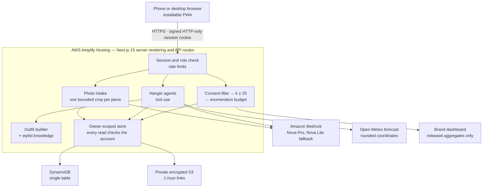

# Racked — Privacy-First Wardrobe Intelligence for Consumers and Brands

[](https://github.com/manof1color/racked-wardrobe-intelligence/actions/workflows/ci.yml)
[](https://github.com/manof1color/racked-wardrobe-intelligence/actions/workflows/codeql.yml)

**Brands know what consumers buy. Racked shows them what consumers actually wear — without ever seeing anyone's closet.**

People get a private wardrobe and an AI stylist that are useful on their own. Brands get consented intelligence about how their products are really worn, released only for groups of at least 25 people — never names, photos, or wardrobes.

| | |
| --- | --- |
| **Judges, start here** | [JUDGES.md](JUDGES.md) — one screen: the two demo flows, how to sign in, and where every piece of evidence is |
| **Live application** | https://main.d2iv0khybuuaeh.amplifyapp.com — installable on a phone |
| **What is deployed right now** | [`/api/version`](https://main.d2iv0khybuuaeh.amplifyapp.com/api/version) returns the exact commit Amplify built |
| **Measured AI recognition** | **92.8% of garments placed in the right category** (272 of 293; 95% CI 89.3%–95.3%) by the live scan, on 300 independent, publicly licensed photos with answers locked before the first model call — up from 89.7% after one measured fix — [results](docs/evaluation-results-r2.md) |
| **Stack** | Next.js 15 · React 19 · TypeScript · AWS Amplify (SSR) · DynamoDB · private S3 · Amazon Bedrock (Nova Pro, Nova Lite) · GitHub Actions · CodeQL |
| **Built for** | CUA Busch School AI Vibe Coding Contest, Fall 2026 |

<!-- pilot:start (generated from data/pilot-status.json; tests/pilot-claims.test.ts) -->
**Pilot status (2026-10-29):** Two apparel brands, **_victimdesigns** and **vversatile.usa**, have agreed to join the Racked pilot, created brand accounts and uploaded their products.

| Brand | What it has done | Evidence |
| --- | --- | --- |
| _victimdesigns | agreed to join the pilot by phone; created a brand account; uploaded products | Agreed by phone; no written record |
| vversatile.usa | agreed to join the pilot by phone; created a brand account; uploaded products | Agreed by phone; no written record |

Not claimed: pricing acceptance and payment. Nothing is billed.
<!-- pilot:end -->

---

## Judge Scorecard

Each scoring category, what to look for, and where to check it.

| Category | Weight | What to look for | Verify it |
| --- | ---: | --- | --- |
| **Problem & relevance** | 20% | Purchase data stops at checkout. Racked measures confirmed wear, consented and released only at 25 or more owners | [What this is](#what-this-is) · [Evidence](#evidence-and-what-is-not-claimed) · [One-page summary](docs/one-page-summary.md) |
| **Functionality** | 25% | Two flows, end to end on the live AWS app. **A person:** photograph clothes → confirm the pieces → get an outfit. **A brand:** an anonymous cohort → wear evidence → a campaign brief | [Live app](https://main.d2iv0khybuuaeh.amplifyapp.com) · [Demo path](#five-minute-judge-path) · [Judge accounts](docs/judge-accounts.md) |
| **AI integration & innovation** | 20% | Nova Pro proposes garments for a person to confirm — **measured at 92.8% category accuracy on 300 locked, independent photos**; Hanger is a **tool-using agent**; a written, tested stylist knowledge base; Brand Hanger sees only privacy-released totals | [How AI is used](#how-ai-is-used) · [Recognition results](docs/evaluation-results-r2.md) · [`hanger-agent.ts`](lib/hanger-agent.ts) · [AI use log](docs/ai-use-log.md) |
| **Code, docs & GitHub** | 15% | **852 tests** in 115 files; CI runs audit, lint, type check, tests, build, [accessibility checks](docs/accessibility.md) and CodeQL on every change; **169 merged PRs** counted on 2026-10-28 before this documentation merge; build log through Phase 89 | [Testing](#testing-and-ci) · [Architecture](#architecture-overview) · [PROGRESS.md](PROGRESS.md) |
| **UX & polish** | 10% | Mobile-first installable app, bottom tabs, a swipe-through Looks builder, whole-piece previews, honest empty and suppressed states | [Open it on a phone](https://main.d2iv0khybuuaeh.amplifyapp.com) · [Brand UX review](docs/brand-ux-review.md) |
| **Business impact** | 10% | Consumers free; brands pay for post-purchase intelligence they cannot get elsewhere; a Starter tier for brands still below the threshold | [Pricing](#business-model--pricing-proposed--not-currently-billed) · [Pricing page](https://main.d2iv0khybuuaeh.amplifyapp.com/pricing) |
| **Bonus** | — | Explicit consent, `k ≥ 25`, a daily enumeration budget, private encrypted storage, two-step sign-in for brands, owner-scoped deletion | [Privacy and security](#privacy-and-security) · [SECURITY.md](SECURITY.md) |

Per-criterion evidence: [docs/competition-checklist.md](docs/competition-checklist.md).

---

## Five-Minute Judge Path

The demo is two flows and nothing else. Everything outside them is built and working, and listed on the [roadmap](#roadmap).

**A person: scan → confirm → recommendation** (2½ minutes) — `judge.consumer@racked.local`

1. **Scan.** Tap **+** and photograph a garment — the one you are wearing works. Amazon Bedrock (Nova Pro) looks for visible pieces in the photo and proposes their categories and types.
2. **Confirm.** Check each card and save. When the AI is unsure, the **Type** field asks instead of guessing; nothing reaches the wardrobe until the person confirms.
3. **Recommendation.** Open **Hanger** (the button at the bottom) and ask *"What should I wear with this today?"* Hanger builds the outfit from pieces this account owns — the new one included — as photo cards with Save and Record.

**A brand: anonymous cohort → wear evidence → campaign brief** (2½ minutes) — `judge.brand@racked.local`

4. **The privacy gate.** Open **Judge Limited Overshirt**: 4 opted-in owners, below `k ≥ 25`, so the brand sees nothing — not zeroes, not even the count — and the page says why.
5. **The anonymous cohort.** Open **Judge Signature Tee**: 50 consented owners, so the aggregate is released — an eight-week wear chart, repeat wear, and what it is worn with. No name, photo, wardrobe, or owner ID is ever shown.
6. **The campaign brief.** Ask **Brand Hanger** *"Write me a campaign brief for this product."* It works only from the released aggregate; on the suppressed product it declines and makes no model call.

---

## Demo Access

| Account | Address | What it shows |
| --- | --- | --- |
| Judge Consumer | `judge.consumer@racked.local` | A lived-in wardrobe: 12 pieces, saved outfits, a realistic wear spread, one **verified** brand piece |
| Judge Brand | `judge.brand@racked.local` | One product with **50 opted-in owners** (released) beside one with 4 (suppressed) |
| New Consumer | `judge.newconsumer@racked.local` | Empty on purpose: scan a real photo and see the first-run states |
| New Brand | `judge.newbrand@racked.local` | No products: enrol one from a single photo with **Fill in from photo** |

**Passwords are deliberately not in this repository.** It is public, and a committed password would let anyone alter the demo before it is reviewed; credentials reach judges privately. Every seeded record is classified `DEMO` and every seeded image is marked `SYNTHETIC DEMO`. The accounts describe repeatable seed expectations, not a live-table audit or real-user statistics. Tour, seeding and the read-only checker (`pnpm verify:judge`): [docs/judge-accounts.md](docs/judge-accounts.md).

---

## What This Is

Purchase history stops at the transaction. It cannot show whether a product was worn once, became a favourite, sat untouched, or anchors outfits with other pieces.

1. **A wardrobe and stylist for people** — photograph your clothes, build outfits, record what you wear, and talk to Hanger, an AI stylist that only ever dresses you from what you own.
2. **Actual-wear intelligence for brands** — confirmed wear, repeat use and pairings for a brand's own products, released only when at least 25 opted-in owners qualify.
3. **Optional public discovery** — an outfit someone deliberately publishes becomes a Community look others can recreate from their own closets.

---

## Architecture Overview


<details>
<summary><strong>The same diagram as text — expand</strong></summary>



</details>

Amplify deploys `main` automatically; DynamoDB is one on-demand table; S3 is private and encrypted with public access blocked; Bedrock runs in `us-east-2` from the app's own AWS account, so no AI key reaches a browser. Details: [docs/architecture.md](docs/architecture.md), including a module map, and every route in [docs/backend-api.md](docs/backend-api.md).

---

## Roadmap

Built, live and tested, but outside the five-minute demo:

| Area | What it does | Where it lives |
| --- | --- | --- |
| **Community & Recreate** | **Private by default:** nothing is public until its owner picks one saved outfit and presses **Publish this outfit**, and only that outfit appears, under new public IDs. **Unpublish** takes it down again at any time (`DELETE /api/community/[postId]`). Anyone signed in can see how much of a public look their own closet makes | [`community-feed.tsx`](components/community-feed.tsx) · [`recreate-look.ts`](lib/recreate-look.ts) |
| **Shop the Look** | Only a registry-verified product with a validated destination is shoppable | [`commerce.ts`](lib/commerce.ts) |
| **Brand linking** | A barcode, or brand plus style code, verifies a piece against the brand registry; look-alikes and search link it as the owner's own pick. A brand name alone verifies nothing | [`product-registry.ts`](lib/product-registry.ts) · [`catalog-match.ts`](lib/catalog-match.ts) |
| **Brand enrollment** | Up to six products at once; **Fill in from photo** proposes the details and the brand supplies the style code. New brands are approved before they can enroll, up to 300 products each | [`brand-product-enrollment.tsx`](components/brand-product-enrollment.tsx) · [brand approval](docs/brand-approval.md) |
| **Batch scanning** | Up to **6 photos** in one pass, every piece in one review list, bounded at 24 pieces | [`garment-intake.tsx`](components/garment-intake.tsx) |
| **Outfits, wear and Looks** | Saved outfits with private flat-lay boards, one-tap repeat wear, and a swipe-through builder that uses the same ranker as Hanger with no AI call | [`looks-builder.tsx`](components/looks-builder.tsx) |

**Next:** raise exact-type recognition (74.6% today) and the dress/top boundary, now the most common miss in the [measured benchmark](docs/evaluation-results-r2.md); a learned segmenter that beats the [measured crop baseline](docs/segmentation-backends.md); Next.js 16 after judging; production password-reset email once Amazon SES grants it; [App Store and Google Play](docs/app-store-launch.md).

---

## How AI Is Used

| Task | Model | When it fails |
| --- | --- | --- |
| Finding the garments in a photo — a consumer scan, or a brand's **Fill in from photo** | Amazon Nova Pro (US profile) | An unreadable result becomes one editable "needs your label" card, never invented attributes |
| Hanger, for consumers and brands | Amazon Nova Pro, Nova Lite as fallback | A reply written without the model is built from the wardrobe and **says so on screen** |
| Weather for Hanger | Open-Meteo — not AI | Coordinates rounded to about 1 km; without a location Hanger never guesses |

**Hanger is an agent, not a script.** Nova Pro reads each message and calls the tools it needs through the Bedrock Converse tool-use API — up to five rounds inside a 22-second budget: `search_wardrobe` (only the signed-in wardrobe), `build_outfits` (the **only** way an outfit reaches the screen), `get_weather`, and `get_trends` (anonymous totals from public looks). A reply listing an outfit the builder never made is corrected once, then abandoned. The conversation and standing preferences live on the account, so "swap the shoes" refers to the right look after a reload.

**Stylist knowledge, written down and tested.** The outfit builder ranks with a curated dataset, not a black box: [`lib/garment-knowledge.ts`](lib/garment-knowledge.ts) puts every garment type on a five-step formality ladder, and a named occasion is a gate before rotation, so "a more formal outfit" reaches for the dressiest pieces owned. [`tests/stylist-regression.test.ts`](tests/stylist-regression.test.ts) holds the regression cases from a real reported closet.

**What the AI is never allowed to do:** put an outfit on screen the builder did not build from owned pieces; verify a brand (only a registry barcode, or brand plus style code, can); state the weather without a forecast; infer body shape, gender, age, ethnicity, income or health; see another account's wardrobe; or give a brand anything below `k ≥ 25`.

### What calls a model, and what does not

**Only the consumer Hanger is an agent** in the strict sense: a model that decides which tools to call. Brand Hanger is a single model call over released aggregates. Everything else is deterministic code that gives the same answer to the same input.

| Action | Calls a model? | What decides | Runs in |
| --- | --- | --- | --- |
| Finding the garments in a photo — a consumer scan, or a brand's **Fill in from photo** | **Yes** — Nova Pro, one call per photo | The model proposes pieces; code crops them, joins shoe pairs, maps them onto the taxonomy, and saves nothing until a person confirms | `lib/look-garment-detection.ts` · `POST /api/garments/detect` |
| A Hanger conversation | **Yes** — Nova Pro, one to five calls per message | The model chooses tools; the tools are code | `lib/hanger-agent.ts` · `POST /api/agents/consumer` |
| Hanger's tools: wardrobe search, outfit builder, Racked trends | No | Search over the account's own pieces; the outfit ranker with the stylist knowledge dataset | `lib/outfit-ranking.ts`, `lib/garment-knowledge.ts` |
| Hanger's weather tool | No — a forecast service, not AI | Open-Meteo, coordinates rounded to about 1 km | `lib/weather.ts` |
| Hanger when the agent cannot answer | Only after a fast failure: one plain reply, no tools | The turn planner and the outfit ranker; the reply says it was written without the stylist model | `lib/hanger-turn.ts` |
| Brand Hanger | **Yes, only when released** — one reply, no tools; **none** below `k ≥ 25` | The privacy gate decides first | `lib/hanger-conversation.ts` · `POST /api/agents/brand` |
| Looks: today's pick, Shuffle, Finish | No | The same outfit ranker, in the browser | `lib/looks-rows.ts` |
| Verifying a brand product from its label code | No | A whole-code GTIN, or brand plus style code, against the registry | `lib/product-registry.ts` |
| Look-alike products and catalog search | No | Weighted attribute match against enrolled products | `lib/catalog-match.ts` |
| "Recreate with my wardrobe" | No | Owned / substitute / missing scoring with per-piece evidence | `lib/recreate-look.ts` |
| Whether a brand may see an aggregate at all | No | Consent filter, `k ≥ 25`, enumeration budget | `lib/privacy.ts`, `lib/metrics.ts` |

> **Is the AI trained on clothing photos? Not by Racked.** Racked uses Amazon Bedrock Nova models as supplied and does not fine-tune them. Where it needs domain knowledge it writes it down and tests it: the controlled garment taxonomy, a reference of 23 generic shoe classes that grounds recognition, and the formality ladder above. Recognition accuracy is measured, not asserted: [92.8% category accuracy on 300 independent photos](#evidence-and-what-is-not-claimed).

---

## Evidence, and what is not claimed

**Recognition accuracy, measured on the live scan (2026-10-29).** Racked ran the exact scan the app runs — the code behind `POST /api/garments/detect`, with the same prompt, the same Nova Pro model and the same 1,600-pixel photo — on photos from the independent CC BY 4.0 [Clothing Dataset for Second-Hand Fashion](https://zenodo.org/records/13788681). Every answer and photo was locked by hash before the first model call, so nothing could be tuned after seeing results.

It ran twice. **Round 1** measured the scan as it was and found its most common mistake: hoodies and cardigans proposed as outerwear, although Racked's own taxonomy files them as tops. The prompt was given that boundary. **Round 2** then measured the fixed scan on **300 fresh photos it had never been tuned on** — none shared with round 1.

| Measure (95% confidence interval) | Round 1 — before the fix | **Round 2 — current scan, fresh photos** |
| --- | --- | --- |
| **Garment category correct** | 262 of 292 — 89.7% (85.7%–92.7%) | **272 of 293 — 92.8%** (89.3%–95.3%) |
| Exact type correct, on photos labelled with a type | 100 of 168 — 59.5% (52.0%–66.6%) | **138 of 185 — 74.6%** (67.9%–80.3%) |
| Hoodies, cardigans and other tops proposed as outerwear | 18 photos | **1 photo** |
| Products marked "verified" by AI alone | 0 | **0** — only registry evidence verifies a product |
| Scans that came back unlabelled | 0 of 292 | 0 of 293 |
| Service timeouts, where the person is offered manual entry | 8 of 300 — 2.7% | 7 of 300 — 2.3% |

Both rounds together cost **$3.51 of Bedrock time** as counted (with a 1.5× safety margin; each round under a hard cap). The most common miss now is a dress proposed as a top (11 photos); every proposal is shown to the person to confirm or change before anything is saved. [Round 2 results](docs/evaluation-results-r2.md) · [Round 1 results](docs/evaluation-results.md) · [method](docs/evaluation.md#live-path-benchmark-the-scan-the-app-actually-runs) · aggregates [round 1](data/evaluation-live-2026-10-29.json), [round 2](data/evaluation-live-2026-10-29-r2.json) · locks [round 1](data/evaluation-lock.json), [round 2](data/evaluation-lock-r2.json)

<!-- real-use:start (generated from data/pilot-usage.json; tests/real-use.test.ts) -->
**Real use: not measured yet.** Racked has counted, since 2026-10-28, how often people keep the AI's proposal for a scanned piece unchanged, as anonymous daily totals for real (non-demo) accounts. The first snapshot will be published here, with any count under 5 shown as "fewer than 5".
<!-- real-use:end -->

**Synthetic demo cohort.** The main cohort seed deterministically defines each of three hero products with **76 confirmed wears across 25 opted-in owners** — reproducible seed expectations, not a live-table audit or real-user statistics. It shows what a brand would see once the privacy gate opens:

| Signal | Seed result | The question it answers |
| --- | ---: | --- |
| Engagement | **22 of 25 active owners (88%)** | How many owners have worn it at least once? |
| Repeat use | **19 of 25 repeat wearers (76%)** | Is it earning repeated use? |
| Zero-wear opportunity | **3 of 25 owners** | Where could styling help? |

Before the benchmark, a label-coverage audit of 1,000 dataset records found **93.9%** map to Racked's categories, **62.6%** are specific enough for exact-type scoring, and **94.0%** carry usable brand annotations. These measure benchmark compatibility, not model accuracy ([report](data/evaluation-label-coverage.json)).

Racked does **not** claim recognition accuracy beyond the measured benchmark above, sales lift, purchase intent, demographic inference, virtual try-on, or production-scale validation. Every seeded record is synthetic and classified `DEMO`. Pricing is a proposal; nothing is billed.

---

## Privacy and Security

The full list, with what is still open, is in [SECURITY.md](SECURITY.md) and [docs/privacy-and-ethics.md](docs/privacy-and-ethics.md).

- **Brands see groups, never people.** Only opted-in owners count, nothing is released below `k ≥ 25`, any figure about fewer than five owners is withheld, and a brand can open at most six distinct products a day so results cannot be lined up. Opting out removes a person from every aggregate at once.
- **Consent is explicit and recorded.** Sharing is off until switched on, and every change is kept with the exact wording the person saw. Publishing to Community is a separate, deliberate act that can be undone.
- **Photos stay private.** Encrypted S3 with public access blocked, links that expire in an hour, location data stripped, and scan photos nobody keeps deleted within two days.
- **AI never decides identity or access.** A brand name read by AI only prefills an unverified label; registry evidence alone verifies a product.
- **Accounts are hardened.** scrypt password hashes, signed HTTP-only sessions, shared sign-in limits, a bot trap, a 90-day activity log without IP addresses, and optional two-step sign-in for brands. New brands are approved before they can enroll anything.
- **Abuse costs the attacker, not Racked.** Rate limits on every write, and daily AI budgets per account and site-wide that fail closed.
- **People can leave.** Deleting a piece, an outfit, a Community look, or the whole consumer account is owner-scoped and retry-safe.

---

## Testing and CI

[`.github/workflows/ci.yml`](.github/workflows/ci.yml) runs a production dependency audit, lint, type check, the full test suite, a production build and [accessibility checks](docs/accessibility.md) (axe on the public pages and, through a fixture-only harness, the signed-in screens, plus keyboard-only passes of both demo flows) on every push and pull request; [`codeql.yml`](.github/workflows/codeql.yml) adds CodeQL. Merges happen only when both are green.

**852 passing tests** in 115 files (verified 2026-10-29). Tests named `REGRESSION:` reproduce a bug found in real use. A local attack harness drives a production build against local DynamoDB to check sign-in, roles, consent and the 25-owner rule ([docs/security-verification.md](docs/security-verification.md)). Documentation checks recompute the numbers in this README from their sources ([`tests/readme-numbers.test.ts`](tests/readme-numbers.test.ts)).

Coverage over the whole suite (2026-10-29): **97.02% of lines, 86.79% of branches, 94.32% of functions**; `privacy.ts` 100% and the session guard 97.56% of branches. Coverage shows what the tests run, not that the scoring is right.

| What is protected | Tests |
| --- | --- |
| Brands see private wear only at `k ≥ 25` | [`privacy`](tests/privacy.test.ts) · [`brand-route-guards`](tests/brand-route-guards.test.ts) · [`brand-integrity`](tests/brand-integrity.test.ts) |
| Sessions, accounts, two-step sign-in and deletion | [`session-guards`](tests/session-guards.test.ts) · [`two-step`](tests/two-step.test.ts) · [`account-and-garment-deletion`](tests/account-and-garment-deletion.test.ts) |
| Only registry evidence verifies a brand | [`product-registry`](tests/product-registry.test.ts) · [`brand-autofill`](tests/brand-autofill.test.ts) |
| Photo recognition and intake | [`look-garment-detection`](tests/look-garment-detection.test.ts) · [`look-scan-resilience`](tests/look-scan-resilience.test.ts) · [`garment-intake`](tests/garment-intake.test.ts) |
| Hanger as an agent and a stylist | [`hanger-agent`](tests/hanger-agent.test.ts) · [`stylist-regression`](tests/stylist-regression.test.ts) · [`garment-knowledge`](tests/garment-knowledge.test.ts) |
| The judge demo | [`judge-accounts`](tests/judge-accounts.test.ts) · [`submission-readiness`](tests/submission-readiness.test.ts) · [`build-version`](tests/build-version.test.ts) |

```text
app/            Pages and API routes — app/api/* is the entire backend
components/     The interface: wardrobe, photo intake, Looks, Hanger, brand dashboard
lib/            Domain logic: AI agents, outfit builder, stylist knowledge, privacy gate, registry
lib/server/     All DynamoDB and S3 access, with every ownership check
tests/          115 test files, 852 tests (node --test)
scripts/        Judge and demo seeds, verification, evaluation, owner-run tools (dry run by default)
infra/          CloudFormation: DynamoDB, S3, least-privilege Amplify compute role
docs/           Judge guides, architecture, privacy, AI use log, evaluation protocol
.github/        CI (audit, lint, type check, tests, build, accessibility) and CodeQL
```

---

## Business Model & Pricing (proposed — not currently billed)

Consumers stay free, which solves cold start; brands pay, because post-purchase wear is what they cannot get elsewhere; and the Starter tier prices the wait before a product reaches `k ≥ 25`. No tier weakens consent or the threshold. See [/pricing](https://main.d2iv0khybuuaeh.amplifyapp.com/pricing).

| Tier | Price | Includes |
| --- | --- | --- |
| Consumer Free | $0 | Wardrobe logging, wear tracking, limited Hanger queries |
| Consumer Pro | $6.99/mo or $59/yr | Unlimited Hanger, advanced analytics, outfit export |
| Brand SKU Enrollment | $25 one-time + $10/yr/SKU | Verification, registry matching |
| Brand Starter (below k≥25) | $29/mo | Category benchmarks, progress-to-threshold visibility only |
| Brand Standard (post-threshold) | $149/mo | Full aggregate dashboard, CSV export |
| Brand Growth | $299/mo | Standard + multi-product comparison + Hanger strategy artifacts |
| A la carte strategy artifact | $15/artifact | For non-subscribers |

---

## Run It Locally

<details>
<summary><strong>Clone, configure, run the gate — expand</strong></summary>

Requirements: Node.js **22.13.0 or newer** and **pnpm 11.9.0**.

```bash
pnpm install --frozen-lockfile
copy .env.example .env.local
pnpm lint && pnpm typecheck && pnpm test && pnpm build && pnpm audit:prod
pnpm test:a11y   # after pnpm build; needs `pnpm exec playwright install chromium` once
pnpm dev
```

Account and upload features need a DynamoDB table, a private S3 bucket and AWS credentials with the permissions in `infra/template.yaml`. Never commit `.env.local`. Before a live demo, `pnpm verify:live` checks the deployed site without signing in.

</details>

---

## Documentation

- **For judges:** [JUDGES.md](JUDGES.md) · [Judge accounts](docs/judge-accounts.md) · [Competition checklist](docs/competition-checklist.md) · [One-page summary](docs/one-page-summary.md) · [Presentation script](docs/demo-script.md) · [Demo checklist](docs/demo-checklist.md)
- **The product:** [User workflow](docs/user-workflow.md) · [Brand linking incentives](docs/brand-linking-incentives.md) · [Brand UX review](docs/brand-ux-review.md) · [Brand approval](docs/brand-approval.md)
- **The engineering:** [Architecture and module map](docs/architecture.md) · [Accessibility](docs/accessibility.md) · [Backend API](docs/backend-api.md) · [AI use log](docs/ai-use-log.md) · [Segmentation and the crop benchmark](docs/segmentation-backends.md) · [AWS deployment](docs/aws-deployment.md) · [Security verification](docs/security-verification.md) · [PROGRESS.md](PROGRESS.md)
- **What may be claimed:** [Privacy and ethics](docs/privacy-and-ethics.md) · [Evaluation protocol](docs/evaluation.md) · [Dataset provenance](docs/dataset-provenance.md) · [Test cohort](docs/test-cohort.md) · [Demo storefronts](docs/demo-storefronts.md)
- **Where it goes next:** [Streamline plan](docs/streamline-plan.md) · [App Store launch](docs/app-store-launch.md) · [TikTok campaign](docs/tiktok-campaign.md)
- **Terms:** [LICENSE](LICENSE) — source-available for reading and evaluation; all rights reserved

---

**Last updated:** 2026-10-29 — test totals and coverage rechecked with the recognition benchmark results
**Repository:** https://github.com/manof1color/racked-wardrobe-intelligence
**Competition:** CUA Busch School AI Vibe Coding Contest, Fall 2026
